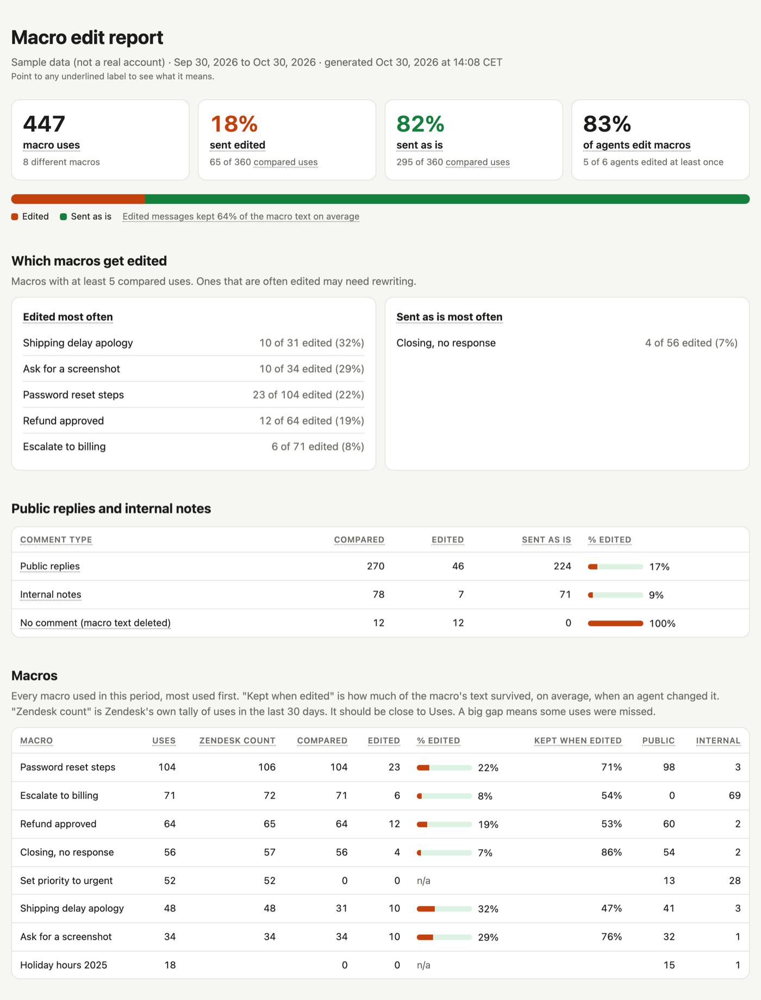

# Zendesk macro edit audit

This tool shows how often agents change a macro's text before they send it.

It looks at the last 30 days of ticket updates in your Zendesk account. Every time an agent applied a macro, it compares the comment they saved with the text the macro inserts. Then it writes:

- **report.html**, a readable report you can open in any browser or share
- **macro_uses.csv**, one row per macro use (who, which macro, public or internal, edited or not, similarity score)
- **macros.csv**, totals per macro
- **agents.csv**, totals per agent

The report covers:

- the percentage of macro uses sent edited and sent as is
- the share of agents who edit macros
- which macros are edited most often, and which are usually sent as is
- public replies and internal notes, counted separately
- every single use, with a view of exactly what the agent changed

Here's the top of a report made from the tool's sample data. Below this part, the full report goes on to list agents, every single use with its changes, and the uses that couldn't be compared. In the report, hover over any underlined label to see what it means.



It needs Python 3.9 or newer and nothing else. There's nothing to install.

## Try it without Zendesk

```bash
python3 zd_macro_audit.py --sample
```

This runs on made-up data and prints where the report was saved.

## One-time Zendesk setup

You need a Zendesk **admin** for this. It takes about two minutes.

There are two ways to sign in.

- **OAuth** is Zendesk's recommended method. It needs the setup below.
- **An API token** skips that setup, if the admin already has one. See [Sign in with an API token](#sign-in-with-an-api-token).

For the OAuth setup, your Zendesk account needs an "OAuth client", which is a small record that tells Zendesk this tool is allowed to ask for access.

1. Sign in to Zendesk as an admin.
2. Open **Admin Center**. Click the four-squares icon in the top bar, then **Admin Center**.
3. In the left sidebar, click **Apps and integrations**, then **APIs**, then **OAuth Clients**. (In some accounts this is **Apps and integrations > APIs > Zendesk API**, then the **OAuth Clients** tab.)
4. Click **Add OAuth client**.
5. Fill in the form.
   - **Name**. Something like `Macro edit audit`. Agents see this name when they approve access.
   - **Description**. Optional.
   - **Company**. Your company name.
   - **Unique identifier**. Zendesk fills this in from the name, for example `macro_edit_audit`. Copy it. This is the client ID the tool asks for.
   - **Client kind**. Choose **Confidential**.
   - **Redirect URLs**. Enter exactly `http://localhost:8765/callback`
6. Click **Save**.
7. Zendesk now shows a **Secret**. Copy it right away, because Zendesk only shows it once. If you lose it, click **Regenerate** on the same page to get a new one.

You'll paste the unique identifier and the secret into the tool the first time you run it. See [Run it](#run-it). The tool saves them in `config.json`, so you only do this once. Keep the secret private, like a password.

## Run it

```bash
python3 zd_macro_audit.py
```

The first time, it asks for your Zendesk subdomain. For `acme.zendesk.com`, that's `acme`. Then it asks how you want to sign in. Choose OAuth, and it asks for two more things.

1. The unique identifier from step 5.
2. The secret from step 7. Nothing shows on screen while you paste or type it, so it stays private. Paste it and press Enter.

It saves these in `config.json` in this folder. Then it opens your browser so you can sign in to Zendesk and click **Allow**. Sign in as an admin, because only admins can read every ticket's history. After that, the browser tab says you can close it, and the tool carries on in the terminal.

Later runs reuse the saved sign-in and go straight to work.

### Sign in with an API token

If the admin already has a Zendesk API token, the tool can use it instead of OAuth. There's no OAuth client to set up and no browser step.

```bash
python3 zd_macro_audit.py --api-token
```

It asks for the admin's email and the token, and saves both in `config.json`. Like the OAuth secret, the token doesn't show on screen as you paste it. Later runs use the saved token without the flag. The token must belong to an admin, because only admins can read every ticket's history.

To find or make a token, go to **Admin Center > Apps and integrations > APIs > API tokens**. Zendesk only shows a new token once, so copy it right away. If that page says token access is off, turn it on there.

In `config.json` the token is saved as `email` and `api_token`. Leave `api_token` empty to use OAuth. If the file holds both an API token and an OAuth client, the token wins. Run with `--oauth` to use OAuth instead.

### Options

| Option | What it does |
| --- | --- |
| `--days 60` | Look back 60 days instead of 30. |
| `--out some/folder` | Save reports somewhere other than `./reports`. |
| `--api-token` | Sign in with an admin's existing API token instead of OAuth. |
| `--oauth` | Sign in with OAuth even if an API token is saved. |
| `--login` | Sign in to OAuth again, for example as a different admin. |
| `--sample` | Use made-up data instead of Zendesk. |
| `--config other.json` | Use a different settings file, for example one per Zendesk account. |
| `--workers 2` | Read 2 tickets at a time instead of 4. Lower this if other tools share your Zendesk API limit. |

You can also pass settings through environment variables instead of `config.json`. Use `ZENDESK_SUBDOMAIN` with either `ZENDESK_CLIENT_ID` and `ZENDESK_CLIENT_SECRET` for OAuth, or `ZENDESK_EMAIL` and `ZENDESK_API_TOKEN` for an API token. Settings from the environment are never written to `config.json`.

### How long it takes

The tool reads the history of every ticket updated in the period, one request per ticket. So the run time depends on how many tickets were updated and on your Zendesk plan's API limit.

| Tickets updated in 30 days | Team plan (200 requests a minute) | Enterprise plan (700 requests a minute) |
| --- | --- | --- |
| 1,000 | about 5 minutes | about 2 minutes |
| 10,000 | about 50 minutes | about 15 minutes |

The tool prints its progress and an estimate of the time left. If Zendesk says the tool is going too fast, it waits and tries again on its own. Other tools that use your Zendesk API share the same limit, so a run during quiet hours goes faster.

## Zendesk endpoints used

All requests are read-only.

| Endpoint | What it's for |
| --- | --- |
| `GET /api/v2/incremental/tickets/cursor` | Lists every ticket updated in the period. |
| `GET /api/v2/tickets/{id}/audits` | Each ticket's history. A "macro reference" event shows a macro was applied, and the "comment" event in the same update shows what was sent. |
| `GET /api/v2/macros?include=usage_30d` | The text of each macro, plus Zendesk's own 30-day usage count. |
| `GET /api/v2/macros/{id}` | Tries to get macros that are missing from the list. |
| `GET /api/v2/dynamic_content/items` | Expands `{{dc.*}}` placeholders. Only called if a macro uses one. |
| `GET /api/v2/users/show_many` | Agent names and emails. |

Zendesk's usage count is a check on the tool. In the report's macro table, "Zendesk count" should be close to "Uses". A big gap means the tool missed some uses. The count needs the Support Professional plan or higher. On other plans the column is left out.

## How "edited" is decided

A use counts as **sent as is** only when the saved comment matches the macro's text exactly, with these exceptions.

- **Placeholders** like `{{ticket.requester.first_name}}` match whatever Zendesk filled in. Filling in a name is never an edit.
- **Dynamic content** like `{{dc.sign_off}}` matches any of its language versions.
- **Liquid blocks** like `...` match whether or not their text appears.
- **Spacing, bold, links, list bullets and curly quotes** are ignored, because the editor changes these on its own.

Every other change counts as an edit, however small. Each use also gets a **similarity score**. 100% means sent as is. A fixed typo scores in the high 90s, and a full rewrite scores much lower. The score shows how much of the macro's wording the agent kept.

If a macro adds text but the agent saved the update with no comment, they deleted all of the macro's text. That counts as edited, with 0% similarity. The report lists these uses as "No comment".

If an agent applied several macros in one update, the comment is compared with all of their text together, in any order. Each macro counts as one use.

### Uses that aren't counted

Some uses can't be judged, so they're left out of the percentages and listed separately in the report.

- **Macro has no comment text.** The macro only sets fields or tags.
- **Macro deleted or unreadable.** The macro no longer exists, so its text is unknown.
- **Macro changed since use.** Zendesk only gives the current version of a macro. If someone edited the macro during the period, older uses that don't match it can't be judged.

## Privacy and access

- The tool only reads from Zendesk. It never changes anything in your account.
- With OAuth, the tool asks Zendesk for **read** access only. Your sign-in is saved in `.tokens/` in this folder, readable only by your user account. Delete that folder to sign out. To cut off access completely, delete the OAuth client in Admin Center.
- An API token can't be limited to reading. It has the same access as the admin who owns it, so treat `config.json` like a password. The file is readable only by your user account. To cut off access, delete the token in Admin Center.
- The report and CSVs contain agent names and parts of ticket comments. Share them the way you'd share any internal support data.

## Files

| File | What it is |
| --- | --- |
| `zd_macro_audit.py` | The command you run. |
| `zdaudit/zendesk.py` | OAuth and API token sign-in, and the Zendesk API calls. |
| `zdaudit/compare.py` | Decides whether a comment matches a macro, and scores similarity. |
| `zdaudit/analyze.py` | Turns raw data into per-use results and totals. |
| `zdaudit/report.py` | Writes the HTML report and CSV files. |
| `zdaudit/sample.py` | The made-up data behind `--sample`. |
| `tests/` | Tests. Run them with `python3 -m unittest`. |

## License

This project uses the MIT License. See [LICENSE](LICENSE).
